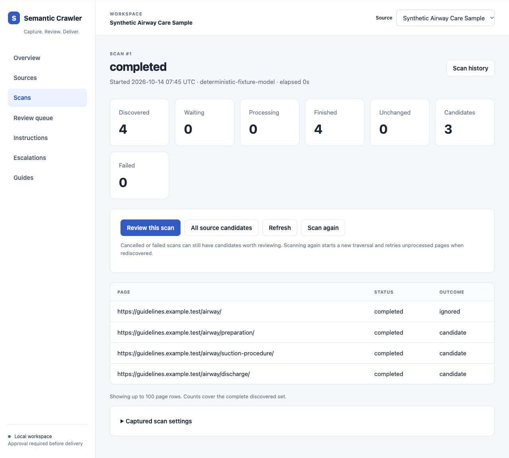
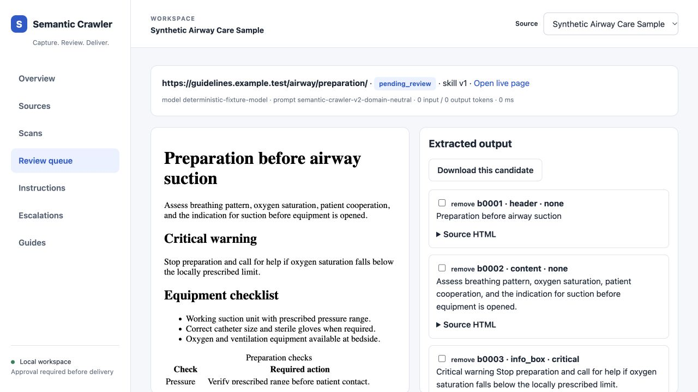

# Semantic Crawler

[](https://github.com/TobiasWilhelmsson/semantic-crawler/actions/workflows/checks.yml)

Extract detailed website content, review it against the original page, and export
approved documents for your own systems.

Originally designed for public-sector organisations, Semantic Crawler supports
all kinds of websites where clean, detailed, source-faithful data matters.
The model selects numbered source blocks; the crawler preserves their wording
and HTML instead of asking the model to rewrite them. Human approval gates
HTTP delivery. Source fidelity does not independently establish that a claim
is true, current or authoritative.



## What it does

- Crawls within a configured hostname, path, page limit and link depth.
- Uses your own OpenAI, Gemini, DeepSeek, Qwen, Z.ai or compatible model endpoint.
- Detects changes and skips unchanged pages when extraction settings match.
- Stores snapshots, candidate versions, decisions and reviewer rules in SQLite.
- Provides local scan progress, cancellation, comparison, review and retries.
- Exports JSON, JSONL, Markdown and text, or delivers approved content over HTTP.

No consuming application, hosted account or captured third-party dataset is
required. The bundled sample and ordinary tests use synthetic offline data.

## Start with the offline sample

Download and extract the [v0.1.0 source release](https://github.com/TobiasWilhelmsson/semantic-crawler/releases/tag/v0.1.0),
then enter its top-level directory. You can also clone the source:

```sh
git clone https://github.com/TobiasWilhelmsson/semantic-crawler.git
cd semantic-crawler
```

Install **Go 1.26.9 or newer**, **Make** and a **C compiler** for SQLite's CGO driver.
On macOS, `xcode-select --install` installs the Command Line Tools. On Linux,
install your distribution's C compiler and Make.

```sh
make setup
make start
```

Open [the local UI](http://127.0.0.1:8091/semantic), choose **Start scan → Offline
sample**, then **Review this scan**. The sample works without an API key or
network access after dependencies are installed. Keep the terminal open;
Ctrl+C stops the server.

Setup downloads dependencies and creates `.env` only if it is missing. It
preserves existing configuration. Starting the UI does not start a scan.
Use `make doctor` for prerequisites and `make help` for commands.

The shell workflow targets macOS and Linux. Windows and WSL execution remain
unverified. Run the binary from the extracted project directory: configuration,
fixtures and UI guides are supporting files, not embedded in the executable.

## Scan a website

Edit the local `.env` with your own provider, model and API key using the
[provider guide](docs/providers.md). Live scans and provider preflight can incur
API charges. Restart the UI after changing provider settings.

```sh
make example.com
```

Replace `example.com` with your site's hostname. This creates or reuses a source,
starts the UI and immediately begins a scan. Defaults: **10 pages**, **link depth
2**, **750 ms between fetches**. Open the scan URL printed in the terminal.

For a specific path or different limits:

```sh
make website URL=https://docs.example.com/guide/ PAGES=25 DEPTH=2
make website URL=https://docs.example.com/guide/ ADDR=127.0.0.1:8093
```

Use the final hostname and path: redirects outside that boundary are refused,
including a redirect to another `www` hostname. `DEPTH=0` scans only the seed.
The shortcut accepts HTTP(S) seed URLs without credentials, queries or fragments.
It prints the source configuration, instruction and database paths. Repeat scans
preserve source identity, instructions and review history.

For finer control, use **Sources → Add source** in the UI, configure its scope
and instructions, then choose **Start scan → Configured model**. No per-page CSS
selectors are required. [Quick start](docs/semantic_quick_start.md) and
[source onboarding](docs/semantic_next_source_onboarding.md) cover the workflow.

## Review and use the results



Compare selected blocks with the stored snapshot. Approve, edit, reject,
escalate or retry with an instruction. Saved URL or source rules guide subsequent
extraction. A failed retry remains queued and can be resumed.

Export approved content locally:

```sh
make export SOURCE=my-source FORMAT=jsonl OUTPUT=exports/my-source.jsonl
make export SOURCE=my-source FORMAT=markdown OUTPUT=exports/my-source-markdown
```

The UI's **Export content** control also downloads JSON/JSONL and Markdown/text
ZIPs. Exports select the latest approved version of each URL and flag newer
unapproved versions. They are portable content, not database backups.
The versioned JSON contract retains selected HTML and provenance; readable
formats include conversion warnings where representation loses detail.
See [output formats](docs/output-formats.md).

HTTP delivery requires approval and an explicitly allowlisted endpoint. The
[reviewer handbook](docs/semantic_reviewer_handbook.md) explains review, retries,
delivery and local recovery.

## Operating boundaries

- The UI is for a trusted local operator. It has no account authentication;
  shared hosting requires additional deployment controls.
- Crawling fetches HTML and follows links. It does not render JavaScript,
  extract PDF files, or read `robots.txt`. Choose sources and crawl permissions
  deliberately; URL queries/fragments are removed from discovered links.
- Live model requests send source content and instructions to your configured
  provider. Local snapshots, raw responses and review history can be sensitive.
- The browser may fetch HTTPS images/styles referenced by a snapshot; source
  scripts and forms are blocked.
- Ctrl+C cancels owned work with bounded cleanup. Interrupted scans can be rerun;
  unchanged completed pages are reused and rediscovered failed pages retried.
- Delivery has no built-in authentication or deduplication. A failed request may
  already have reached the receiver; the receiver must handle duplicates.

Local databases, reports, exports and generated source configurations/instructions
stay out of ordinary Git staging. To back up a source, stop its processes and
copy its database with any SQLite sidecars, JSON config and instructions. Use a
new `DB` path for a fresh demo instead of deleting history:

```sh
make demo DB=data/fresh-demo.db
make start DB=data/fresh-demo.db
```

## Benchmarks

**98.8% first-pass text F1 across 57 pages in a GLM provider run, reaching 99.3% after the benchmark review process.** The comparison used a human-prepared selector baseline. Of the 57 evaluated pages, 48 passed the recorded model quality gate through first-pass output, learned rules, or feedback; nine required benchmark-controlled corrections.

The recorded run used prototype evaluator v20 on 8–9 July 2026. It stopped after a stable streak at **57 of 164 planned pages**; the scores describe those 57 pages. It has not been rerun against this standalone release.

The reference was prepared by people who crawled the pages and chose selectors for the content they wanted to retain. **The benchmark compares the crawler's selections with those human selections, page by page**, with separate checks for text coverage, critical warnings, tables, media, section roles, content types, and Markdown inclusion settings. The extraction pipeline selects original source HTML blocks, preserving their sentence wording rather than asking the model to rewrite the text.

| Stage | Pages scored | Text F1 | Critical-content recall | Intervention |
| --- | ---: | ---: | ---: | --- |
| First pass | 57 | **98.8%** | 72.3% | Model output before feedback on that page |
| With existing rules | 57 | **98.8%** | 83.4% | Model output using accumulated instructions |
| After new reviewer prompts | 17 | **98.0%** | 95.7% | Additional baseline-guided model attempts on the prompted subset |
| Final approved output | 57 | **99.3%** | **100%** | Includes simulated source-block edits or baseline replacement on nine pages |

Text F1 measures agreement in normalized text tokens, not sentence order, grammar, exact extraction, or clinical correctness. Feedback and corrections in this benchmark were generated automatically from the human-prepared baseline. The human contribution was preparing the reference selections; this run does not measure people reviewing the crawler's output or record how many people prepared the reference. The prompted subset differs from the whole run. See [benchmark evidence and methodology](docs/benchmark_results.md) for provenance, approval methods, and metric definitions.

The standalone project's bundled synthetic evaluation was verified on 13 October 2026:

| Check | Result | What it demonstrates |
| --- | ---: | --- |
| Expected pages captured | **4 / 4** | Scoped discovery reaches every expected sample page |
| First-pass pipeline text F1 | **98.5%** | Extracted text agrees closely with the synthetic gold baseline |
| Critical-content / table / media recall | **100% / 75% / 100%** | Category-specific baseline agreement, including the remaining table mismatch |
| Model calls on the unchanged second crawl | **0** | Successfully processed unchanged pages reuse stored results |
| Final parity after simulated review | **100%** | Review corrections can bring the sample into agreement with its baseline |

The synthetic evaluation uses a deterministic fixture model and spends no model tokens. Run it with `make eval`; it demonstrates pipeline behavior rather than live-provider accuracy. Dated code and platform checks are recorded in [verification notes](docs/verification.md).

## Develop and contribute

```sh
make test race vet lint build
make fmt-check mod-check
make benchmark proof reviewer-learning REPORT_ROOT=artifacts/my-fresh-experiment
```

Ordinary tests and fixture workflows make no paid provider calls. They test
software behavior; they cannot prove a live model will select every important
passage. [Testing](docs/testing.md) explains that distinction and report resume
rules. Live-provider accuracy, Windows execution and authenticated shared hosting
remain unverified; dated platform/CI evidence is in [verification](docs/verification.md).

- [Contributing](CONTRIBUTING.md) — setup, package map and safe reproductions.
- [Security](SECURITY.md) — boundaries and private reporting configuration.
- [Changelog](CHANGELOG.md) — capabilities and compatibility.
- [Releasing](docs/releasing.md) — source packaging and publication inventory.

## License

MIT. Copyright © 2026 Tobias Wilhelmsson. See [LICENSE](LICENSE).
Dependencies retain their own licences; see the [dependency licence inventory](docs/dependencies.md).
`go.mod` and `go.sum` identify versions.
